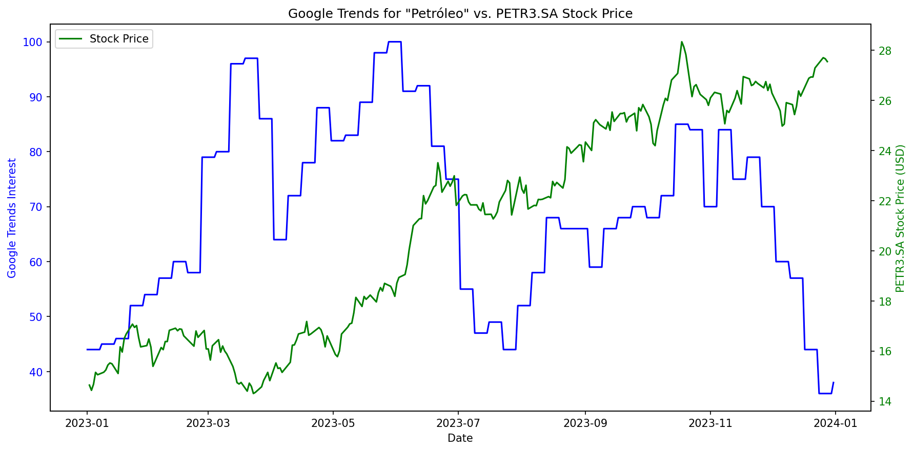

# Google Trends vs. Stock Price Analysis

Análise exploratória que compara o interesse de busca por termos no Google Trends com o histórico de preços de ações do mercado financeiro, utilizando Python.

## Sobre o projeto

Este projeto coleta, prepara e compara dados de diferentes fontes para explorar o comportamento do interesse de busca e dos preços de ativos financeiros ao longo do tempo.

Como exemplo, é analisado o interesse de busca pelo termo "Petróleo" em comparação com o preço das ações ordinárias da Petrobras (PETR3).



## Objetivos

- Coletar dados de diferentes fontes por meio de bibliotecas Python.
- Preparar e organizar séries temporais.
- Comparar visualmente indicadores com escalas distintas.
- Explorar possíveis relações entre o interesse de busca e os preços das ações.

## Tecnologias utilizadas

- **Python** — linguagem utilizada no desenvolvimento.
- **Pandas** — manipulação e preparação dos dados.
- **Pytrends** — consulta aos dados do Google Trends.
- **yfinance** — obtenção do histórico de preços de ações.
- **Matplotlib** — geração dos gráficos.

## Fontes de dados

- [Google Trends](https://trends.google.com/) — índice relativo de interesse de busca.
- [Yahoo Finance](https://finance.yahoo.com/) — histórico de preços dos ativos financeiros.

## Metodologia

1. Coleta do interesse de busca pelo termo selecionado.
2. Obtenção do histórico de preços do ativo financeiro.
3. Preparação das séries temporais para visualização.
4. Geração de um gráfico com dois eixos verticais para comparar o comportamento das variáveis ao longo do período analisado.

## Como executar

### Pré-requisitos

- Python instalado.
- Conexão com a internet para consultar as fontes de dados.

### Instalação

Clone o repositório:

```bash
git clone https://github.com/mluiz18/google-trends-stock-analysis
cd google-trends-stock-analysis
```

Crie um ambiente virtual e instale as dependências:

```bash
python -m venv .venv
python -m pip install -r requirements.txt
```

Ative o ambiente virtual antes de executar o projeto.

No Windows:

```bash
.venv\Scripts\activate
```

No Linux ou macOS:

```bash
source .venv/bin/activate
```

### Execução

```bash
python main.py
```

Os gráficos gerados são salvos no diretório `images/`.

## Limitações

- O Google Trends fornece um índice relativo de interesse, não o número absoluto de buscas.
- A comparação visual não comprova correlação estatística nem causalidade.
- As fontes podem apresentar frequências e calendários de observação diferentes.
- A disponibilidade e a atualização dos dados dependem dos serviços utilizados.

## Possíveis melhorias

- Calcular correlações entre séries temporais devidamente alinhadas.
- Comparar retornos das ações, além dos preços absolutos.
- Permitir análises com diferentes palavras-chave, ativos e períodos.
- Adicionar testes automatizados e tratamento mais robusto de erros.